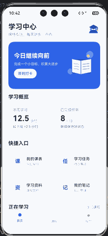
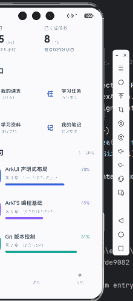

# 实验02：声明式布局与基础组件（HarmonyOS）

这是移动开发课程的第二次实验，基于 **HarmonyOS / ArkTS / ArkUI（Stage 模型）**，使用 DevEco Studio 创建一个“学习中心”静态设计页面，并通过少量交互展示声明式状态更新。

## 实验要求及实现位置

| 实验目标 | 相关实现 |
|---|---|
| 声明式容器嵌套、主轴和交叉轴对齐 | `Index.ets` 中的 `Column`、`Row`、`Flex`；`justifyContent` 和 `alignItems` |
| 弹性布局及权重分配 | 概览卡片、顶部文字区域的 `.layoutWeight(1)`，底部 `Flex` 分配空间 |
| 基础组件 | `Text`、`Image`、`Button`、`Scroll`、`Row`、`Column` |
| 不同尺寸的屏幕适配 | `vp`、`100%`、`GridRow` 和 `GridCol`，基于窗口宽度的断点 |
| 设计稿的容器—组件拆解 | 下方的页面结构树、卡片组件和 `@Builder` 分区 |

## 目录与关键文件

```text
AppScope/
  app.json5                            应用级配置
entry/
  src/main/ets/
    entryability/EntryAbility.ets       UIAbility 应用入口
    pages/Index.ets                    学习中心页面、组件和布局
  src/main/resources/base/media/
    student_avatar.png                 学生头像
    study_banner.png                   主页插画
  src/main/module.json5                模块、Ability、页面配置
  build-profile.json5                  模块构建配置
build-profile.json5                    工程构建与 SDK 参数
hvigorfile.ts                          构建入口
oh-package.json5                       依赖声明
```

## 页面容器结构

```text
Column（屏幕主体）
├── Scroll（可滚动内容；layoutWeight(1)）
│   └── Column（五个分区）
│       ├── Row：标题 / 副标题 + Image 头像
│       ├── Row：Banner（文本 + 按钮 + Image 插画）
│       ├── Column：学习概览
│       │   └── Row：两个 MetricCard（等权宽度）
│       ├── Column：快捷入口
│       │   └── GridRow → GridCol → ShortcutCard
│       └── Column：课程列表
│           └── CourseCard（每门课程含进度条）
└── Flex：底部静态导航栏（三个等权导航项）
```

页面代码将 `MetricCard`、`ShortcutCard`、`CourseCard` 拆成可复用的 `@Component`，各个区域通过 `@Builder` 构建，并通过 `ForEach` 的稳定 `id` 渲染列表。

### 响应式说明

`GridRow` 使用基于 `vp` 的窗口断点 `320vp`、`600vp`、`840vp`。快捷入口在狭窄宽度下采用 1 列，在普通手机宽度下采用 2 列，在较宽的窗口下采用 4 列。大小尺寸主要采用 `vp` 和百分比，避免固定像素值。

## 运行方法

1. 用 DevEco Studio 选择 `Open` 打开本仓库目录。
2. 检查 HarmonyOS SDK 与构建依赖，完成 Project Sync。
3. 启动 HarmonyOS Phone 模拟器（`Tools → Device Manager`）。
4. 顶部选择运行配置 `entry` 及模拟器，点击 `Run`。
5. 验证首页、向上滑动查看课程卡片，并点击“签到打卡”验证状态更新。

> 本仓库保留原始工程的包名和 SDK 配置；没有上传本地 `local.properties`、缓存或编译产物。

## 实验截图

以下截图来自实验02在 HarmonyOS Phone 模拟器上的实际运行，展示了页面顶部与滚动后的课程列表。仓库中的 PNG 是为网页浏览优化过的裁切与压缩版本。

### 01. 学习中心首页



### 02. 页面下半部分



后续如需补充工程目录及适配过程，可添加 `03-project-structure.png`、`04-responsive-layout.png`。

## 版本控制

在 GitHub 的 `main` 分支存放工程源码、配置及运行截图；排除 `oh_modules`、`.hvigor`、`.idea`、`build`、`local.properties` 等本地文件。